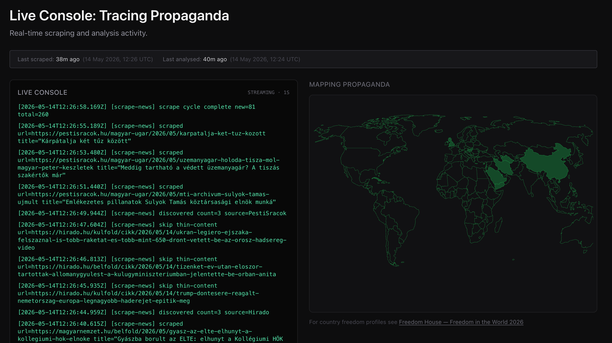
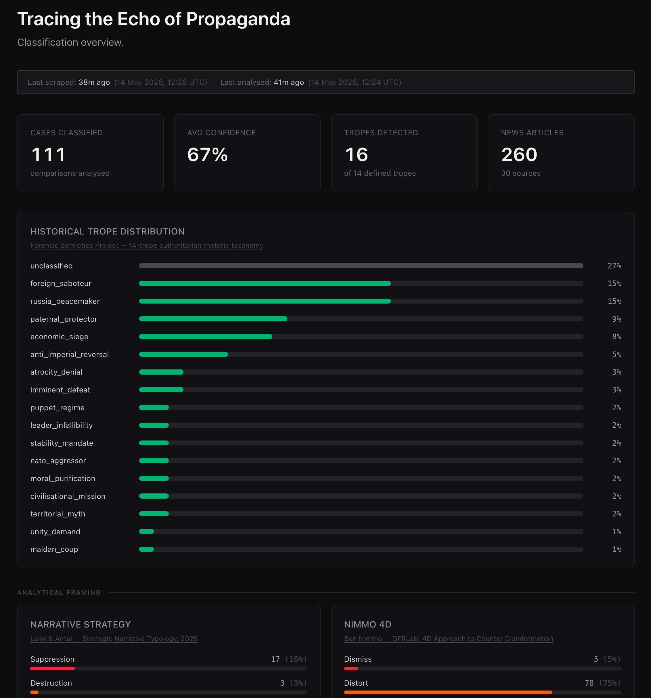

# ECHO/trace

**Authoritarian propaganda does not invent new language. It inherits it.**

ECHO/trace is an autonomous AI-powered pattern-matching system that exposes this inheritance in real time. Every six hours, it scrapes 21 state media outlets in authoritarian states, identifies rhetorical patterns using a 22-trope taxonomy, and matches them against a curated archive of 88 historical quotes from 70 figures spanning the 20th and 21st centuries. A control corpus of public-service broadcasters in democracies runs through the identical pipeline, so every echo can be read against a baseline.

The output: forensic pairings that juxtapose today's propaganda with its structural ancestors — a Putin spokesman echoing Goebbels, Chinese state media recycling Stalin, Iranian broadcasts mirroring Mussolini.

## How it works

The system operates as a digital archaeologist, analyzing each article across 18 scientific dimensions drawn from propaganda studies, semiotics, and genocide prevention research. It searches for structural DNA matches across an archive reaching from Nazi Germany and Stalinist USSR to Pinochet's Chile, Gaddafi's Libya, apartheid South Africa, and the military juntas of Latin America — using semantic vector search to find rhetorical parallels regardless of which regime or era they come from.

The analysis is clinical; the conclusions are implicit in the parallelism.

Just parallel quotes, timestamped and traced.

**Making inheritance visible is the point.**

---

## Screenshots

**Live Console — real-time scraping log and world map**



**Dashboard — trope distribution and analytical framing**



---

## Table of Contents

1. [What It Does](#what-it-does)
2. [Architecture](#architecture)
3. [Method](#method)
4. [Analytical Dimensions](#analytical-dimensions)
5. [Trope Taxonomy](#trope-taxonomy)
6. [Monitored Sources](#monitored-sources)
7. [Archive Verification](#archive-verification)
8. [Setup](#setup)
9. [Running](#running)
10. [Web Frontend](#web-frontend)
11. [Tech Stack](#tech-stack)
12. [Data Formats](#data-formats)

---

## What It Does

1. **Scrapes** article text from 21 state-controlled outlets (and 7 control outlets) and stores it once in SQLite
2. **Classifies** each article, source-blind, with Claude: picks the key claim verbatim, decides whether it is propaganda at all, assigns one of 22 tropes, and annotates 18 analytical dimensions
3. **Matches** the claim against the historical archive: Voyage AI embeddings shortlist up to five candidates above a similarity threshold, and Claude chooses one by index — or answers that none shares the rhetorical logic
4. **Copies** the chosen historical quote, figure, year, context and citation from the archive (never re-typed by the model) and writes a divergence note
5. **Records** every outcome — echo, no echo, not propaganda — so echo rates can be compared between state media and the control corpus
6. **Publishes** results to a Next.js gallery and dashboard, with each historical quote's verification status shown
7. **Streams** live execution logs to the Live Console at `/console`, with a world map of the state outlets being scraped

## Architecture

```
┌──────────────────────────────────────────────────────────────────────┐
│  Crontab (every 6 hours) → scripts/cycle.sh                          │
│                                                                      │
│  Phase 1: scrape-news.mjs                                            │
│    sources.mjs (21 state + 7 control outlets)                        │
│    RSS / HTML / Puppeteer discovery → extract text once              │
│    (Readability → JSON-LD → <p> → Puppeteer)                         │
│    → articles table (status = pending)                               │
│                                                                      │
│  Phase 2: analyze-new.mjs — every pending article, one process       │
│    1. Classify, source-blind (Claude Sonnet, structured output)      │
│       key claim (verbatim) · propaganda yes/no · trope · 18 dims     │
│    2. Snap claim to a verbatim span of the article                   │
│    3. Embed English claim (Voyage) → cosine vs archive echoes        │
│       top_similarity stored for every article                        │
│    4. Gate: propaganda ∧ trope ∧ confidence ≥ 0.4                     │
│    5. Candidates ≥ ECHO_MIN_SIMILARITY (top 5)                        │
│    6. Claude picks index or −1 + divergence note                     │
│    7. Write comparison; update article outcome                       │
└──────────────────────────────────────────────────────────────────────┘
                              │
                              ▼
            agent/data/echo-trace.db (SQLite)
              ├── articles         (every scraped article + outcome)
              ├── comparisons      (propaganda-classified articles)
              └── echo_embeddings  (Voyage vectors of archive quotes)
                              │
                    ┌──────────────────────────┐
                    │  Next.js frontend (web/) │
                    └──────────────────────────┘
```

### Scripts

| Script | npm script | Purpose |
|---|---|---|
| `scripts/cycle.sh` | `npm run cycle` | Cron entry point: scrape, then analyse |
| `scripts/scrape-news.mjs` | `npm run scrape` | Discover and extract new articles (`--source`, `--regime`, `--corpus`, `--limit`) |
| `scripts/analyze-new.mjs` | `npm run analyze` | Analyse all pending articles and retry failures (`--limit`, `--corpus`, `--dry-run`) |
| `scripts/analyze-one-url.mjs` | — | Analyse one URL (`--force` to re-run) |
| `scripts/check-archive.mjs` | `npm run archive:check` | Automated citation check; writes the verification worklist |
| `scripts/verify-echo.mjs` | `npm run archive:verify` | Record a manual verification decision for one quote |
| `scripts/precompute-embeddings.mjs` | `npm run archive:embed` | Embed new/changed archive quotes |
| `scripts/calibrate-threshold.mjs` | `npm run calibrate` | Compare similarity distributions of state and control; recommend a threshold |
| `scripts/migrate-legacy.mjs` | — | One-time migration from the v2 data model (already run) |
| `scripts/sources.mjs` | — | Source list (state + control) |
| `scripts/lib/*.mjs` | — | Shared modules: extraction, archive, embeddings, Claude calls, pipeline |

## Method

ECHO/trace is an art work, not a research instrument — it shows patterns rather than proving claims. The method is designed so that the patterns it shows are honest:

**Source-blind analysis.** Neither prompt is told the outlet, country or corpus, and nothing tells the model it is reading authoritarian media. A BBC article and a KCNA article are processed by exactly the same code and prompts.

**"No" is a valid answer.** The classifier decides whether the key claim is propaganda at all; ordinary reporting is not. The echo step may answer that no historical statement shares the rhetorical logic (shared topic is not enough). Both outcomes are recorded.

**Control corpus.** Seven public-service outlets in democracies (BBC, Yle ×2, SVT, DW, NOS, RFI — world desks only) run through the identical pipeline. The dashboard shows state media and control side by side: share classified as propaganda, echo rate, share of Nazi-figure echoes, mean dehumanisation. The gap between the two is the finding. Control entries are browsable in the gallery under *Control corpus*.

**Verbatim quotes on both sides.** The contemporary quote is a span of the article text (checked; marked when only the nearest sentence could be matched). The historical quote, figure, year, context and citation are copied from the archive by id — the model only chooses an index. Archive quotes carry a verification status, shown in the UI.

**Similarity threshold.** `top_similarity` (nearest archive echo, before any propaganda judgement) is stored for every article. `npm run calibrate` shows its distribution per corpus and recommends `ECHO_MIN_SIMILARITY`. Early tests show raw embedding similarity tracks topic and register more than rhetoric — unrelated control articles reach 0.55–0.6 — so the threshold mainly trims the candidate list; the classifier gate and the model's "no parallel" answer do the real filtering. The primary baseline metric is therefore the pipeline echo rate, not raw similarity.

**Provenance.** Every comparison stores the models, `PROMPT_VERSION` and archive version that produced it, so entries can be traced and re-run after changes.

**Known limits.** One model call annotates all 18 dimensions; they are not validated against human coders. The EUvsDisinfo narratives were defined for pro-Kremlin content. The archive leans toward Nazi and Soviet sources. Topic mix differs between corpora even with world-desk feeds.

## Analytical Dimensions

Each comparison is annotated across 18 scientific dimensions. Dimensions marked **[v2]** were added in version 2.0 to support regime-agnostic classification beyond the original Russia–Ukraine scope.

### Structural propaganda frameworks

| Dimension | Values | Source |
|---|---|---|
| **narrative_strategy** | `suppression` · `destruction` · `direction` · `exploitation` | Lank & Antai — *Strategic Narrative Typology*, International Journal of Communication, 2025 · [doi.org/10.1177/19401612251317696](https://doi.org/10.1177/19401612251317696) |
| **ellul_type** | `agitation` (mobilise for action) · `integration` (normalise existing order) | Jacques Ellul — *Propaganda: The Formation of Men's Attitudes* (1965) · [Wikipedia](https://en.wikipedia.org/wiki/Propaganda_(Ellul_book)) |
| **ellul_axis** | `vertical` (top-down state messaging) · `horizontal` (peer-group diffusion) | Jacques Ellul — *Propaganda* (1965) |
| **nimmo_4d** | `Dismiss` · `Distort` · `Distract` · `Dismay` | Ben Nimmo — DFRLab / EUvsDisinfo · [euvsdisinfo.eu/the-4d-approach](https://euvsdisinfo.eu/the-4d-approach/) |

### Technique taxonomies

| Dimension | Values | Source |
|---|---|---|
| **san\_martino\_techniques** | 18 techniques: Appeal to Authority · Appeal to Fear/Prejudice · Bandwagon · Black-and-White Fallacy · Causal Oversimplification · Doubt · Exaggeration/Minimisation · Flag-Waving · Loaded Language · Name Calling/Labeling · Obfuscation/Vagueness · Red Herring · Repetition · Slogans · Straw Man · Thought-terminating Clichés · Transfer · Whataboutism | Da San Martino et al. — *Fine-Grained Analysis of Propaganda in News Articles*, ACL 2019 · [aclanthology.org/W19-2006](https://aclanthology.org/W19-2006/) |
| **ipa\_techniques** | 7 techniques: Name-calling · Glittering generalities · Transfer · Testimonial · Plain folks · Card stacking · Bandwagon | Institute for Propaganda Analysis — *7 Techniques* (1937) · [Wikipedia](https://en.wikipedia.org/wiki/Institute_for_Propaganda_Analysis) |
| **eco\_properties** | 14 features of Ur-Fascism: Cult of Tradition · Rejection of Modernism · Action for Action's Sake · Disagreement is Treason · Fear of Difference · Frustrated Middle Class · Obsession with a Plot · Enemies Too Strong and Too Weak · Pacifism as Collaboration · Contempt for the Weak · Selective Populism · Newspeak · Education Toward Heroism · Machismo and Weaponry | Umberto Eco — *Ur-Fascism*, New York Review of Books (1995) · [Wikipedia](https://en.wikipedia.org/wiki/Ur-Fascism) |

### EUvsDisinfo dimensions

| Dimension | Values | Source |
|---|---|---|
| **eudisinfo\_narratives** | `Nazis` · `Lost Sovereignty` · `Threatened Values` · `Elites vs People` · `Imminent Collapse` · `Russia as Victim` | EUvsDisinfo — [Disinformation Cases Database](https://euvsdisinfo.eu/disinformation-cases/) |
| **eudisinfo\_rhetoric** | SWAMPED: `Straw Man` · `Whataboutism` · `Attack` · `Mockery` · `Provocations` · `Exhaust` · `Denial` | EUvsDisinfo — [Modus Trollerandi](https://euvsdisinfo.eu/modus-trollerandi-the-kremlin-rhetoric/) |
| **eudisinfo\_conspiracy** | `Shadow Government/Deep State` · `Anglo-Saxon Plot` · `Color Revolution Conspiracy` · `Soros Conspiracy` · `Gay/LGBTQ Lobby` · `Big Pharma/Vaccine Conspiracy` · `Rothschilds/Banker Conspiracy` · `False Flag` | EUvsDisinfo — [Disinformation Cases Database](https://euvsdisinfo.eu/disinformation-cases/) |
| **eudisinfo\_ttp** | Fabricated Content · Manipulated Content · False Attribution · False Context · Conspiracy Amplification · Narrative Laundering · Strategic Decontextualization · Emotional Manipulation · Infoshum · Firehose of Falsehood · Data Void Exploitation · Forced Confessions · Impersonation · Fake Experts · Video/Image Manipulation | DISARM Framework — [disarmframework.com](https://www.disarmframework.com/) |

### Political myth and narrative structure **[v2]**

| Dimension | Values | Notes | Source |
|---|---|---|---|
| **myth\_function** | `cosmogonic` · `eschatological` · `theodicy` · `heroic` · `providential` | founding myth · final battle · suffering is meaningful · leader as saviour · historical mission | Flood — *Political Myth* (Routledge, 2002); Tudor — *Political Myth* (Macmillan, 1972) |
| **enemy\_type** | `external` · `internal` · `ontological` · `shadow` | foreign actor · traitor/fifth column · constitutionally inferior · occult/conspiratorial hidden enemy | Volkan — *The Need to Have Enemies and Allies* (1988); Keen — *Faces of the Enemy* (1986) |
| **legitimation\_mode** | `authorization` · `moral` · `rationalization` · `mythopoesis` | appeal to authority · appeal to values · instrumental justification · narrative/historical justification | van Leeuwen — *Discourse and Practice* (Oxford UP, 2008) · [doi](https://academic.oup.com/book/26629) |
| **frame\_function** | `diagnostic` · `prognostic` · `motivational` | defines problem & blame · proposes solution · emotional mobilisation | Snow & Benford (1988); Entman — *Framing*, J. of Communication 43(4) (1993) · [doi](https://doi.org/10.1111/j.1460-2466.1993.tb01304.x) |
| **dehumanisation\_level** | 1–10 | 1=Classification · 2=Symbolisation · 3=Discrimination · 4=Dehumanisation · 5=Organisation · 6=Polarisation · 7=Preparation · 8=Persecution · 9=Extermination · 10=Denial | Stanton — *Ten Stages of Genocide* (Genocide Watch, 1996/2013) · [genocide.watch](https://www.genocide.watch/ten-stages-of-genocide) |
| **temporality** | `retrospective` · `contemporaneous` · `prospective` | golden age / historical grievance · present crisis · victory narrative / promised future | Flood — *Political Myth* (2002); Mink — *History and Fiction as Modes of Comprehension*, New Literary History 1(3) (1970) |
| **greimas\_actantial** | subject · object · sender · receiver · helper · opponent | hero · goal · mandate-giver · beneficiary · ally · villain | Greimas — *Sémantique structurale* (1966); Propp — *Morphology of the Folktale* (1928) · [Wikipedia](https://en.wikipedia.org/wiki/Actantial_model) |

---

## Trope Taxonomy

The taxonomy in `archival-memory.json` covers 22 rhetorical tropes. Each entry contains modern keywords for detection, 88 historical echoes in total, each with a source citation and a verification status (see [Archive Verification](#archive-verification)), and full annotation across all 18 dimensions above.

### Kremlin-aligned tropes (v1.0 — 14 tropes)

| ID | Theme |
|---|---|
| `foreign_saboteur` | External Threat / Foreign Interference |
| `paternal_protector` | The Cult of the Infallible Leader |
| `moral_purification` | Traditional Values vs. Modern Degeneracy |
| `nazi_label` | Labelling the Enemy as Nazi / Fascist |
| `territorial_myth` | Territorial Revisionism and the 'One People' Claim |
| `maidan_coup` | Delegitimising Democratic Uprisings as Foreign-Backed Coups |
| `covert_operations` | Secret Western Bioweapons, Labs, and Hidden Aggression |
| `atrocity_denial` | Denying or Fabricating Evidence of War Crimes |
| `color_revolution` | Civic Protests Reframed as CIA-Engineered Colour Revolutions |
| `puppet_regime` | Denying Sovereignty: The Target State as Western Puppet |
| `imminent_defeat` | Ukraine / The West is Losing and Will Collapse |
| `nato_aggressor` | NATO Expansion as Existential Provocation |
| `russia_peacemaker` | Russia as the Rational Peace-Seeker Forced into War |
| `genocide_reversal` | Accusing the Victim of Genocide to Justify Intervention |

### Regime-agnostic tropes (v2.0 — 8 tropes)

These tropes recur across authoritarian regimes regardless of geopolitical alignment — covering Myanmar, Eritrea, Syria, Cuba, Turkmenistan, Iran, Venezuela and others.

| ID | Theme | Typical regimes |
|---|---|---|
| `leader_infallibility` | The Infallible Ruler Cannot Err — Failure Belongs to Traitors | Eritrea, Turkmenistan, North Korea, Cuba, Myanmar |
| `anti_imperial_reversal` | Western Criticism as Neo-Colonialism / Imperialist Interference | Cuba, Venezuela, Zimbabwe, Eritrea, Iran, Syria |
| `civilisational_mission` | Our Regime Carries a World-Historical Civilisational Mission | Russia, China, Iran |
| `stability_mandate` | Strong Rule Is Necessary to Prevent Chaos and Civil War | Syria, Myanmar, Egypt, Zimbabwe |
| `economic_siege` | Western Sanctions and Blockades Are Acts of War Against Civilians | Cuba, Venezuela, Iran, Syria, Russia, North Korea |
| `media_lie` | All Independent and Western Media Is Fabricated Propaganda | All — universal authoritarian trope |
| `unity_demand` | Internal Dissent in a Time of National Crisis Is Treason | All — universal during wars and crises |
| `ethnic_protection` | The Regime Must Protect an Ethnic or Religious Group from Persecution | Russia/Donbas, Serbia/Bosnia, Turkey/Cyprus |

---

## Monitored Sources

**Inclusion rule (state corpus):** state-owned or state-controlled outlets in countries rated *Not Free* by Freedom House. Outlets are defined in `scripts/sources.mjs`.

| Regime | Outlets |
|---|---|
| **Russia** | TASS · en.kremlin.ru · government.ru |
| **China** | Xinhua · China Daily · People's Daily · Global Times |
| **North Korea** | KCNA (HTTP fallback — HTTPS not reliably served) |
| **Cuba** | Granma · Prensa Latina · Cubadebate (es) |
| **Iran** | Press TV · Tehran Times |
| **Saudi Arabia** | SPA — Saudi Press Agency (JS-rendered; Puppeteer) |
| **Belarus** | BelTA · SB Belarus (ru) |
| **Eritrea** | Shabait `[RSS]` |
| **Turkmenistan** | TDH |
| **Myanmar** | Global New Light of Myanmar `[RSS]` |
| **Tajikistan** | Khovar `[RSS]` |
| **Eswatini** | Eswatini Observer `[RSS]` (owned by the King's Tibiyo Taka Ngwane fund) |

**Control corpus** — public-service media, world/foreign desks, all `[RSS]`:

| Country | Outlets |
|---|---|
| United Kingdom | BBC News — World |
| Finland | Yle News (en) · Yle Uutiset — Ulkomaat (fi) |
| Sweden | SVT Nyheter — Utrikes (sv) |
| Germany | DW — World (en) |
| Netherlands | NOS — Buitenland (nl) |
| France | RFI (en) |

*Removed in v3:* Origo, Magyar Nemzet, Hirado, PestiSracok (Hungary — change of government), Al Jazeera, Middle East Eye, Saudi Gazette, SANA, SABA, SPS, Times of Eswatini. Their earlier comparisons are hidden (not deleted; `hidden = 1`).

> **Note:** Some Russian sources are blocked under EU sanctions. Scraping requires a non-EU VPN or server.
> **Note:** Use of a VPN or other anonymisation method is strongly advised to avoid exposing the scraping origin to authoritarian regime infrastructure.

## Archive Verification

Every historical echo in `archival-memory.json` has a stable `id`, a `year`, and a `verification` block:

| `verification.status` | Meaning | Shown in UI |
|---|---|---|
| `verified` | Quote found word-for-word in the cited source | plain |
| `translation` | Faithful translation of a verified original | plain |
| `paraphrase` | Not the figure's own wording | marked *paraphrase* |
| `unverified` | Not yet checked (default) | marked *quote unverified* |
| `rejected` | Cannot be sourced | never used for matching |

Workflow:

```bash
npm run archive:check          # fetch every cited URL, test whether the quote is on the page,
                               # write agent/data/archive-worklist.md (ordered by priority)
npm run archive:verify -- <id> verified "Calvin GPA, para 4"
npm run archive:verify -- <id> translation "Own translation; Opera Omnia vol. 21 p. 362" \
    --quote "corrected wording" --url https://… --citation "…" --year 1925
npm run archive:verify -- <id> rejected "No primary source found"
npm run archive:verify -- --list unverified
npm run archive:embed          # refresh the match index after quote changes / rejections
```

The automated check (`verification.auto`) never sets the status — that is a human decision. Set `ECHO_REQUIRE_VERIFIED=1` to match only against verified and translated quotes once enough of the archive is checked. The UI reads verification status live from `archival-memory.json`, so decisions show up without re-running the pipeline.

## Setup

### Prerequisites

- Node.js 22.9+ (`--env-file-if-exists` is used by the npm scripts)
- An Anthropic API key (Claude Sonnet for classification and echo selection; Claude Haiku for fallback translation)
- A Voyage AI API key. Without a payment method on the Voyage account the API is limited to 3 requests/minute (the pipeline backs off and waits); adding one lifts the limit while the free token allowance still applies.
- Chromium (for Puppeteer — auto-downloaded on `npm install`)

### Install

```bash
git clone <repo-url>
cd echo-trace
npm install
cd web && npm install && cd ..
```

### Environment

```bash
cp .env.example .env   # fill in ANTHROPIC_API_KEY and VOYAGE_API_KEY
```

`.env` is gitignored. `cycle.sh` and the npm scripts load it automatically. Optional tuning variables (thresholds, model overrides) are listed in `.env.example`.

### Seed the embedding index

```bash
npm run archive:embed
```

Embeds every usable archive quote with `voyage-3.5-lite` (quote text only, as `document`). Incremental — only new or changed quotes are embedded.

## Running

### Full cycle (scrape + analyse)

```bash
npm run cycle
```

### Step by step

```bash
npm run scrape -- --corpus control --limit 10   # scrape only
npm run analyze -- --dry-run                   # list pending articles
npm run analyze                                # analyse pending + retry failed (max 3 attempts)
node --env-file=.env scripts/analyze-one-url.mjs "https://tass.com/politics/…" --force
```

### Calibrate the similarity threshold

After the control corpus has 30+ analysed articles (ideally 100+):

```bash
npm run calibrate
```

Then set `ECHO_MIN_SIMILARITY` in `.env`. Changing prompts? Bump `PROMPT_VERSION` in `scripts/lib/llm.mjs`; the baseline statistics only count articles analysed with a recorded prompt version.

### Automated scheduling (crontab)

```bash
crontab -e
0 */6 * * * cd /path/to/echo-trace && bash scripts/cycle.sh >> /var/log/echo-trace.log 2>&1
```

## Web Frontend

A Next.js app in `web/`. Reads comparisons and articles directly from `agent/data/echo-trace.db` via `better-sqlite3`, and verification status from `archival-memory.json`. The dashboard, comparisons list, and comparison detail pages use ISR (`revalidate = 21600`) so rendered HTML is cached for 6 hours — matching the pipeline cadence — and rebuilt in the background after the cache expires. The console page is fully dynamic. Supports 9 UI locales via `next-intl` with URL-based routing (`/[locale]/...`); the default locale (`en`) is served at `/`.

```bash
cd web
npm run dev     # http://localhost:3000
npm run build   # production build
npm run start   # production server
```

### Routes

| Route | Purpose |
|---|---|
| `/[locale]/` | Landing / About page |
| `/[locale]/comparisons` | Gallery of state-media comparisons; `?corpus=control` shows the control corpus |
| `/[locale]/comparisons/[id]` | Detail view — modern quote and speaker, historical echo with citation and verification status, divergence note, 18-dimension analysis, provenance |
| `/[locale]/dashboard` | Baseline (state vs control), stat cards, dimension charts, source activity with echo rates |
| `/[locale]/console` | Live Console — streaming log + world map |
| `/api/logs` | SSE endpoint — event-driven push from `cycle.log` via `fs.watch` |
| `/api/map-status` | JSON endpoint — active/processed countries for world map |
| `/api/status` | JSON endpoint — last scrape, last analysis and whether a cycle is running (status bar) |

### Dashboard sections

- **Baseline**: echo rate, propaganda share, mean nearest-echo similarity, Nazi-figure share and mean dehumanisation — state media vs control corpus
- **Stat cards**: total comparisons, average confidence, tropes detected, articles scraped
- **Historical Trope Distribution**: ranked bar chart of all matched tropes
- **Analytical Framing**: Narrative Strategy (Lank & Antai) and Nimmo 4D
- **Ellul — Propaganda (1965)**: type (agitation/integration) and axis (vertical/horizontal)
- **Technique Taxonomies**: Da San Martino 18 techniques, IPA 7 techniques, Eco Ur-Fascism 14 features
- **EUvsDisinfo Dimensions**: Pro-Kremlin Narratives, Rhetoric (SWAMPED), Conspiracy Patterns, TTP Framework
- **Source Activity**: article counts, echo rate and last-seen dates per outlet (control outlets marked)

### Live Console

- Real-time log stream from `cycle.log` via SSE; event-driven via `fs.watch` — no polling
- Interactive world map (`react-simple-maps`) highlighting countries as they are scraped
- Link to Freedom House — Freedom in the World 2026 for country freedom profiles

### Internationalisation

The UI is available in 9 locales: **English** (en), **French** (fr), **German** (de), **Russian** (ru), **Chinese** (zh), **Italian** (it), **Spanish** (es), **Portuguese** (pt), **Zulu** (zu). A language switcher in the navigation bar changes the locale in-place. All comparisons and scraped-article translations remain in UK English regardless of the selected UI locale.

---

## Tech Stack

| Layer | Technology |
|---|---|
| Analysis scripts | Node.js 22.9+ (ESM), Bash |
| AI / LLM | Anthropic Claude via `@anthropic-ai/sdk` — `claude-sonnet-5-5` (classification, echo selection; structured outputs, prompt caching, server-side refusal fallback), `claude-haiku-5-5` (fallback translation). Override with `ECHO_MODEL_*`. |
| Semantic embeddings | Voyage AI `voyage-3.5-lite` — asymmetric retrieval (`document` / `query`) |
| HTML parsing | Cheerio, Mozilla Readability, jsdom |
| Browser automation | Puppeteer (one shared browser per process) |
| Web framework | Next.js, React |
| Internationalisation | next-intl — 9 locales, URL-based routing |
| Styling | Tailwind CSS 4 |
| World map | react-simple-maps + world-atlas |
| Database | SQLite (`better-sqlite3`) — `agent/data/echo-trace.db` |
| Scheduling | cron |

## Data Formats

### `agent/data/echo-trace.db` (SQLite)

#### `articles` table

One row per scraped article; the pipeline's state machine.

| Column | Meaning |
|---|---|
| `url`, `source`, `regime`, `corpus`, `language`, `title`, `published_at`, `retrieved_at` | Article identity (`corpus` = `state` or `control`) |
| `body`, `extraction_method` | Extracted text, extracted once by the scraper |
| `status` | `pending` → `done` · `failed` (retried up to 3×) · `skipped` · `legacy` (imported v2 data, never re-analysed) |
| `outcome` | `echo` · `no_echo` · `not_propaganda` · `extraction_failed` · `refused` · `error` |
| `is_propaganda`, `top_similarity` | Classifier verdict; cosine to the nearest archive echo (stored for every analysed article) |
| `comparison_id`, `prompt_version`, `attempts`, `last_error`, `analyzed_at` | Links and bookkeeping |

#### `comparisons` table

One row per propaganda-classified article (outcome `echo` or `no_echo`). JSON columns: `tropes`, `analysis`, `historical_echo`, `models`.

Main columns: `contemporary_quote` (verbatim, original language), `contemporary_quote_en`, `speaker`, `speaker_type`, `claim_verbatim`, `historical_parallel` (trope theme), `tropes`, `confidence`, `analysis` (18 dimensions + `is_propaganda`, `rationale`, `shared_logic`), `historical_echo` (`{ id, figure, year, quote, context, source }`, copied from the archive), `echo_id`, `similarity`, `divergence_note`, `corpus`, `outcome`, `models`, `prompt_version`, `archive_version`, `hidden`.

`hidden = 1` hides an entry from the UI without deleting it (used for outlets no longer monitored and never-classified v2 entries).

#### `echo_embeddings` table

Voyage vectors of archive quotes: `echo_key` (= archive echo id), `trope_id`, `figure`, `quote`, `context`, `source`, `embedding` (Float32 bytes), `model`, `quote_hash` (stale rows are ignored and refreshed by `npm run archive:embed`).

### `archival-memory.json`

- `_meta.dimensions` — machine-readable definitions of all 18 dimensions; the classifier prompt and its output schema are generated from it
- `rhetorical_tropes` — 22 tropes, each with `taxonomy`, `modern_keywords`, `historical_echoes` and `modern_examples`
- each historical echo: `id`, `figure`, `year`, `quote`, `context`, `analogy_link`, `source { citation, url }`, `verification { status, notes, checked_by, checked_at, auto }`

## License

GPL v3

See LICENSE file for more.
